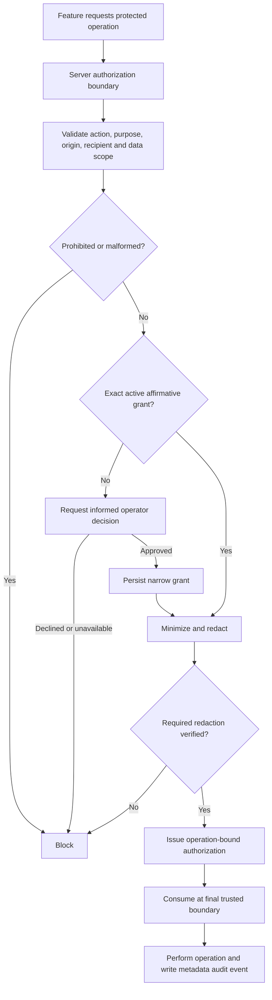

# ADR-0014: Centralized Privacy & Consent Enforcement

- Status: Proposed
- Date: 2026-11-05
- Issue: #359
- Relates: ADR-0006 (screenshot privacy), ADR-0010 (server-owned policy), ADR-0011 HIM confirmation/anti-replay, ADR-0012 sensitive-field redaction, architecture/perception-privacy.yml

## Context

CyberControl has multiple independent paths that may read customer data, capture page content, send data to external providers or MCP clients, and persist snapshots/traces. Examples include MCP profile and screenshot tools, Agent/Teach provider calls, transliteration, and trace persistence.

A Chrome host permission authorizes browser access; it does not authorize onward disclosure. An authenticated MCP client or workspace session likewise does not establish consent for every customer-data operation.

Existing architecture decisions already require server-owned policy, purpose-bound screenshot confirmation, redaction before transmission, and prohibition on observing or persisting OTP/password/payment/CAPTCHA values. The privacy subsystem must extend and enforce those decisions, not weaken or replace them.

## Decision

1. **One server-owned authorization boundary.** Sensitive reads, external transfers, and sensitive persistence must be authorized by a shared server-side policy layer immediately before the protected operation.
2. **Three distinct scopes.** Website access, sensitive-data access, and external transmission are separate permissions. None implies another.
3. **Narrow affirmative consent.** A consent grant is bound to subject, action, purpose, recipient and exact endpoint where relevant, source origin, data categories, optional field names, expiry, and revocation state.
4. **No implicit grants.** Browser host permissions, MCP authentication, workspace membership, a generic AI toggle, or a prior approval for another purpose/recipient are not consent.
5. **Fail closed.** Missing, expired, revoked, malformed, or scope-mismatched grants do not authorize the operation.
6. **One-time operation authorization.** The runtime authorization capability must be short-lived, operation-bound, non-replayable, and validated/consumed at the final trusted boundary. Storage and concurrency semantics are specified in a later implementation phase.
7. **Minimize before release.** Request only required fields. Redaction must happen before sensitive bytes cross a process or network boundary. If required redaction cannot be verified, block.
8. **Secrets remain prohibited.** OTP, password, CAPTCHA, and payment credential values are never read, transmitted, or persisted by CyberControl.
9. **Metadata-only audit.** Record the decision, purpose, recipient, origin, data categories, timestamps, and reason code. Do not record raw payloads, screenshots, profile values, tokens, or hashes of secrets.
10. **Local work remains local.** Lack of external-transfer consent must not block unrelated local form filling.

## Consent decision flow

## Implementation phases

- **Part 1 — Policy foundation:** shared server-side request/grant types, pure fail-closed policy evaluator, policy unit tests, and repository-wide inventory of sensitive reads, egress, screenshot return, and sensitive persistence.
- **Part 2 — Consent lifecycle:** durable scoped grant storage, explicit approval protocol, short-lived single-use operation authorization, revocation, expiry, replay and concurrency protection.
- **Part 3 — MCP:** gate profile tools and screenshot return; minimize profile output and enforce screenshot disclosure/redaction.
- **Part 4 — Agent and Teach:** gate all provider calls and minimize outbound prompts.
- **Part 5 — Other egress and persistence:** transliteration and remaining third-party transfers; trace minimization, retention and deletion.
- **Part 6 — Operator controls:** central Privacy & Permissions UI, audit history, documentation, and packaged artifact verification.

## Consequences

- Feature modules cannot authorize themselves; they must call the server privacy boundary.
- UI approval is only a user decision signal. The server validates the request, creates the grant, and issues the operation authorization.
- Existing screenshot and HIM ADRs remain normative. If this ADR conflicts with them, the stricter privacy rule applies.
- Each phase is independently reviewable and must include tests proving that denied or unapproved operations cannot proceed.
